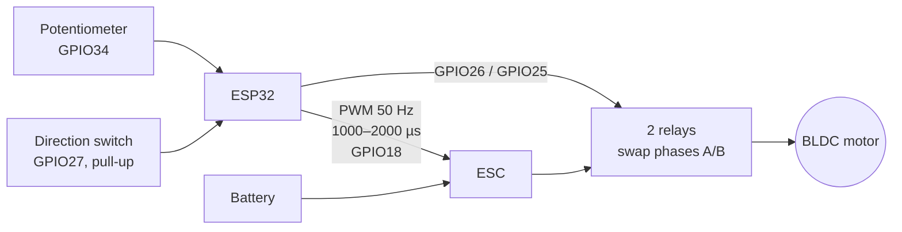
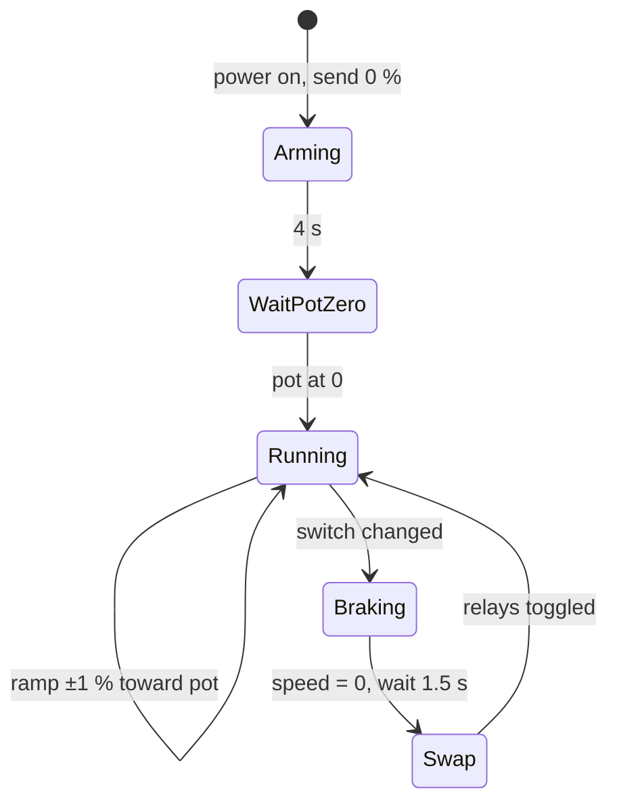

# Brushless Motor Control with an ESP32 + ESC (speed & direction)

Controls a brushless (BLDC) motor through a hobby **ESC**. A potentiometer sets the speed from 0 to 100 % and a switch reverses the rotation. A standard ESC can only spin one way, so direction is changed with **two relays that swap two of the motor phases**. The firmware makes sure that swap only happens once the motor has stopped.

> Electronics lab project, B.Sc. Mechatronics Engineering, Universidad Militar Nueva Granada.

## System

| Signal | Pin |
|---|---|
| ESC signal | GPIO18 |
| Speed potentiometer | GPIO34 (ADC, 11 dB) |
| Direction switch | GPIO27 (`INPUT_PULLUP`) |
| Relay 1 / Relay 2 | GPIO26 / GPIO25 |

## Firmware features

- **ESC protocol:** 50 Hz servo PWM where 1000 µs means 0 % and 2000 µs means 100 % (`ESP32Servo`), plus an optional **calibration mode** that sends max and then min throttle.
- **Arming and start-up interlock:** the ESC is armed at 0 %, and the motor will not start until the potentiometer has been brought back to 0. This prevents a sudden spin-up at power-on.
- **Clean speed input:** the ADC is averaged over 16 samples, with dead-bands at 0–3 % and 97–100 % and a configurable `VEL_MAX` cap for safe testing.
- **Soft ramp:** speed changes by 1 % every 10 ms, so the motor never gets a step command.
- **Safe direction reversal:** when the switch changes, the firmware ramps down to 0, waits 1.5 s for the motor to stop, swaps the phases with the relays, then ramps back up. Phases are never switched under load.
- **Debounced switch** (50 ms) and support for active-low relay modules (`RELE_ACTIVO_BAJO`).
- **Serial telemetry** at 4 Hz: speed %, pulse width in µs, direction.

## Run it

1. Install the **ESP32Servo** library, select board **ESP32 Dev Module** and flash `firmware/brushless_esc/brushless_esc.ino`.
2. For a first test, set `VEL_MAX = 50`. If the relays work backwards, set `RELE_ACTIVO_BAJO = true`.
3. To calibrate a new ESC, set `CALIBRAR = true` once and follow the Serial Monitor.

> ⚠️ Run the first tests with the propeller removed. The relay contacts must be rated for the motor's phase current.

## What I learned

- How ESCs work: the servo PWM protocol, arming and throttle calibration.
- Why reversing a BLDC means swapping two phases, and why that must only happen at zero speed.
- Designing firmware around safe states: interlocks, ramps and debouncing.

---

<b>🇪🇸 Versión en español</b>

## Control de motor brushless con ESP32 y ESC

Un potenciómetro fija la velocidad del motor (0–100 %) a través del ESC, y un interruptor cambia el sentido de giro. Como el ESC gira en un solo sentido, la dirección se invierte con dos relés que intercambian dos fases del motor.

El firmware incluye:

- Armado del ESC y modo de calibración.
- Bloqueo de arranque: el motor no arranca si el potenciómetro no está en 0.
- Promedio del ADC y rampa suave de velocidad.
- Antirrebote del interruptor.
- Cambio de sentido seguro: frena hasta 0, espera, intercambia las fases y vuelve a acelerar.

Práctica de Electrónica, Ingeniería Mecatrónica, UMNG.

